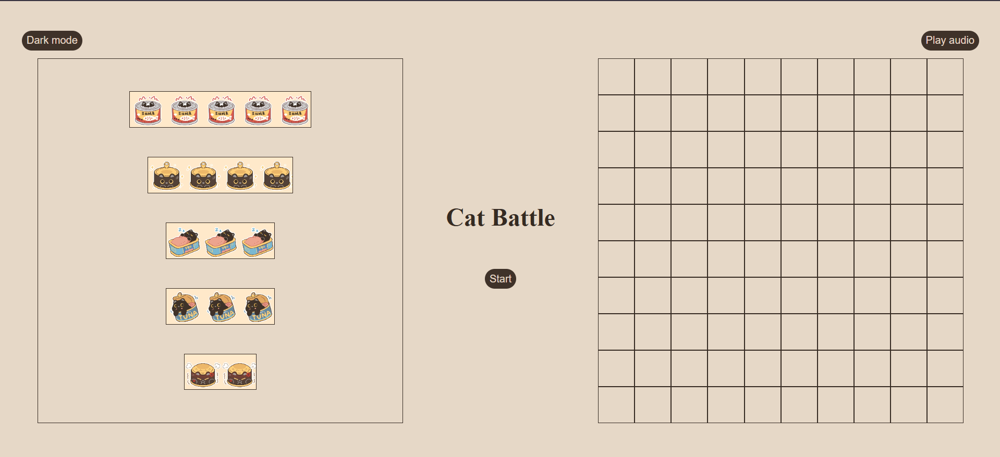
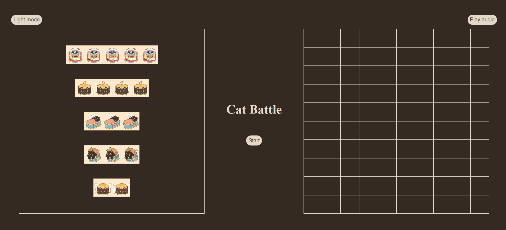
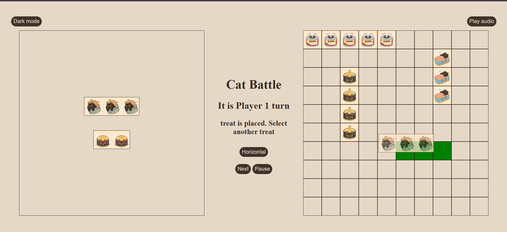
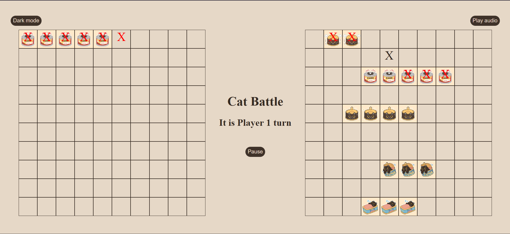
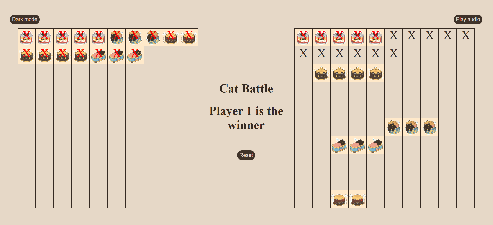

# Project Name
Cat Battle

## Technologies Used
1. HTML
2. CSS
3. JavaScript

## Description
This is a classic battleship game but with cats and treats. The players can place treats by selecting a treat and a starting position or by dragging and dropping the treats. The players can select a box on the opponent's grid to hit a treat. The player can win by eating all of the treats on the opponent's grid.

## User Stories
1. As a user, I want to view the grid and treats
2. As a user, I want to place the different sized treates into the board
3. As a user, I want to seclect a place on the grid to eat the oponent's treat 
4. As a user, I want to see my gruid with my treats and the oponent's gruid with my selection
5. As a user, I want to see a comfermation if I hit a treat and it I eate it
6. As a user, I want to see the winner

## Screenshots

## Future Enhancements
1. Computer vs Player

